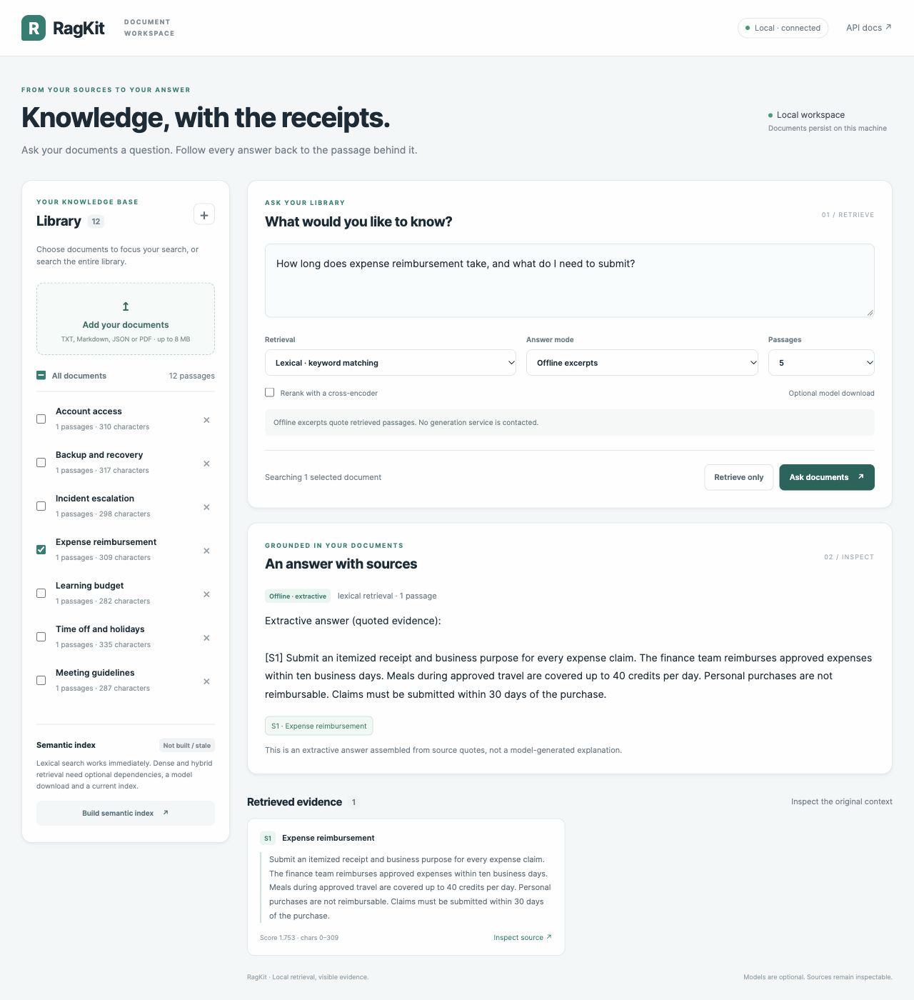

# RagKit

**Your documents. Answers with inspectable sources.**

[](https://github.com/sunilkumar123ss/RagKit/actions/workflows/verify.yml)

A local document workspace with persistent storage, hybrid retrieval, reranking, cited answers, a web interface, and API/CLI/MCP integrations. Start offline, then enable actual semantic models or a configured answer provider.



## Start locally

Python 3.10+; from this repository:

```sh
python3 -m venv .venv
source .venv/bin/activate
python -m pip install -e '.[web]'
ragkit sample
ragkit serve
```

Open **http://127.0.0.1:8000**. Ask “How long does expense reimbursement take?” or upload your documents. The bundled handbook is entirely synthetic.

This setup needs no API key, model download or hosted database. Offline answers are explicitly labeled **extractive**: they assemble source excerpts, rather than claim language-model generation. The library persists in `.ragkit` in the current directory. Set `RAGKIT_DATA_DIR` or pass `ragkit --data-dir /path/to/library ...` to change it.

## Features

| Capability | Implementation |
| --- | --- |
| Library | TXT, Markdown, structured JSON, text PDF and pasted text; SQLite persistence; inspect and delete documents |
| Evidence | Overlapping chunks, exact Unicode offsets and citations into the original stored text |
| Retrieval | Deterministic BM25; actual Sentence-Transformers embeddings in persistent local Qdrant; reciprocal rank fusion |
| Reranking | Actual CrossEncoder over query/passage pairs |
| Answers | Offline extractive mode, OpenAI Responses, Anthropic Messages and local Ollama Chat adapters |
| Interfaces | Responsive web workspace, FastAPI/OpenAPI, CLI, MCP stdio tools and LangChain retriever adapter |
| Evaluation | Labeled synthetic corpus; recall@k, MRR@k, nDCG@k, per-query rankings and measured latency |

Scanned PDFs need OCR before ingestion. PDF offsets refer to extracted text, not page coordinates. Uploaded documents are treated as text and never executed as code or HTML. Uploads are limited to 8 MiB and one million extracted characters per document.

## Semantic retrieval

```sh
python -m pip install -e '.[web,dense]'
export HF_HOME="$PWD/.ragkit/models"
ragkit index
ragkit search 'How much time can I take away from work?' --mode hybrid --rerank
```

The first index build downloads `sentence-transformers/all-MiniLM-L6-v2`; the first reranked query downloads `cross-encoder/ms-marco-MiniLM-L6-v2`. Both run locally and disable remote model code. Configure alternatives through `RAGKIT_EMBEDDING_MODEL` and `RAGKIT_RERANKER_MODEL`.

The web app also has **Build semantic index**. Adding, replacing or deleting documents makes that index stale; rebuild explicitly. Identical re-imports do not invalidate it. RagKit reports missing/stale indexes and model failures instead of silently substituting lexical search.

Qdrant uses embedded local mode. Run **one process per data directory**: stop the web server before using the same semantic index in a CLI/MCP process. BM25, cosine, fusion and reranker scores are ranking signals, not confidence probabilities or proof of relevance.

## Answer providers

Install `python -m pip install -e '.[web,providers]'`, configure a provider, then select it in the UI or use `ragkit ask 'your question' --provider NAME`.

| Provider | Configuration |
| --- | --- |
| `extractive` | No configuration; default local excerpts |
| `ollama` | Running Ollama and an installed model; `RAGKIT_OLLAMA_MODEL`; optional `OLLAMA_HOST` (defaults to `http://127.0.0.1:11434`) |
| `openai` | `OPENAI_API_KEY` and `RAGKIT_OPENAI_MODEL` |
| `anthropic` | `ANTHROPIC_API_KEY` and `RAGKIT_ANTHROPIC_MODEL` |

The Python app reads **exported environment variables**, not a `.env` file automatically. Docker Compose reads `.env`. `.env.example` contains configuration names and defaults without credentials.

OpenAI/Anthropic receive the question and selected excerpts when explicitly selected. Keys stay server-side. No model is called when no sources are found. Provider calls bound context and timeouts, validate source IDs, and report malformed output or service errors. Citation validation proves that referenced text exists, **not** that a generated claim logically follows from it.

## CLI and API

```sh
ragkit ingest notes.md handbook.pdf records.json
ragkit documents
ragkit search 'backup recovery' --top-k 3
ragkit ask 'backup recovery' --provider extractive
ragkit search 'backup recovery' --document-id sample-backups
ragkit show sample-backups
ragkit delete sample-backups
ragkit status
ragkit --help
```

JSON accepts one record, an array, or `{"documents": [...]}`. Each record needs `title` and `text`; `id` and `source` are optional. An explicit existing ID replaces that document atomically. Without an ID, identical title/source/text gets a stable ID; changed content creates another document.

Open **http://127.0.0.1:8000/docs** for the API schema.

```sh
curl http://127.0.0.1:8000/api/status
curl -X POST http://127.0.0.1:8000/api/sample
curl -X POST http://127.0.0.1:8000/api/answer \
  -H 'Content-Type: application/json' \
  -d '{"query":"How long does reimbursement take?","mode":"lexical","provider":"extractive","top_k":3}'
curl -X POST http://127.0.0.1:8000/api/upload -F 'file=@notes.md'
```

Other routes: `GET /api/documents`, `GET/DELETE /api/documents/{id}`, `POST /api/documents`, `POST /api/search`, and `POST /api/index`. The server restricts Host headers and browser write origins. This is a single-user local workspace; authentication, tenant isolation and internet deployment are outside its scope.

## MCP and LangChain

```sh
python -m pip install -e '.[mcp,langchain]'
ragkit --data-dir /absolute/path/to/library mcp
```

MCP uses the supported 1.x SDK over stdio, with search/answer tools over the existing corpus and no arbitrary filesystem or shell tool. Configure your client with the absolute `.venv/bin/ragkit` executable and the arguments above. The LangChain adapter returns Documents with citation metadata. See [integration examples](docs/INTEGRATIONS.md).

## Tests and evaluation

```sh
python -m pip install -e '.[web,providers,mcp,langchain,dev]' 'qdrant-client>=1.15,<2'
python -m pytest -q -m 'not live_models'
ragkit evaluate --mode lexical --output benchmark-results.local.json

# With the dense extra installed:
RAGKIT_RUN_LIVE_MODELS=1 python -m pytest -q -m live_models
ragkit evaluate --mode hybrid --rerank --output benchmark-results.local.json
```

The 12-document, 24-question evaluation is a hand-labeled **synthetic demonstration**, not a production benchmark or evidence of CV claims. Reports include all queries, document-level deduplication, settings and actual measurement time. Model startup affects timings. [Verification evidence](docs/VERIFICATION.md) distinguishes actual model runs, test doubles and untested services.

GitHub Actions tests Python 3.10, 3.12 and 3.13. A manually enabled job tests real embedding/reranker models; paid provider requests never run in CI. The original standalone demo and eight tests remain available via `python main.py` and `python -m unittest test_main`.

## Docker

```sh
docker compose up --build
```

The app runs as a non-root user, publishes only `127.0.0.1:8000`, and persists the corpus/model cache in a named volume. Default dependencies include dense retrieval and providers. Set `RAGKIT_EXTRAS=web` before building for a smaller lexical-only image. Credentials are not copied into the image. Docker is optional for native use.
